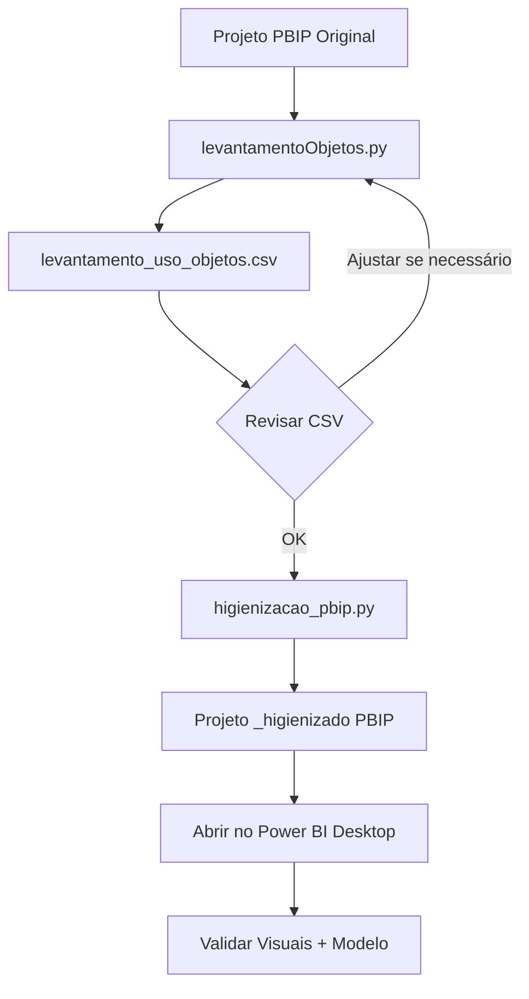

# Auditoria e Higienização de Projetos Power BI (PBIP)

> **Toolkit em Python** para auditoria completa e higienização automatizada de projetos Power BI no formato PBIP.
> Desenvolvido para garantir qualidade, rastreabilidade e limpeza de modelos semânticos e relatórios.

---

## 📋 Visão Geral

Este toolkit é composto por **dois scripts principais** que trabalham em conjunto:

| Script | Função |
|--------|--------|
| `levantamentoObjetos.py` | **Auditoria** — Mapeia todos os objetos (colunas, medidas, colunas calculadas) e classifica seu uso |
| `higienizacao_pbip.py` | **Higienização** — Remove objetos não utilizados e gera projeto PBIP limpo |

---

## 🔍 `levantamentoObjetos.py` — Auditoria de Uso de Objetos

### O que faz

Analisa **modelo semântico** (dependências DAX) e **relatório** (visuais, filtros, páginas) para classificar **cada objeto** (colunas, medidas, colunas calculadas) em três categorias:

| Status | Significado |
|--------|-------------|
| ✅ `Utilizada` | Alcança um visual (direta ou via cadeia de dependências) |
| ⚠️ `Cadeia sem uso real (verificar)` | Usada no modelo, mas não alcança nenhum visual |
| ❌ `Não utilizada` | Sem referências em lugar algum |

### Como funciona (4 etapas)

| Etapa | Descrição |
|-------|-----------|
| **1. Extração** | Lê todos os `.tmdl` em `definition/tables/` + `relationships.tmdl` + JSONs do relatório (`visual.json`, `page.json`, `report.json`) |
| **2. Dependências DAX** | Constrói grafo `uses_of` / `used_by` via regex `\[Nome\]` nas expressões |
| **3. Referências no Relatório** | Varre recursivamente todos os JSONs do relatório buscando `SourceRef.Entity` + `Property` |
| **4. Propagação (BFS)** | Propaga uso efetivo a partir dos visuais → medidas → colunas |

### Saída

| Arquivo | Descrição |
|---------|-----------|
| `levantamento_uso_objetos.csv` | CSV completo (separador `;`, UTF-8-BOM) com classificação de todos os objetos |

**Colunas do CSV:**
| Coluna | Descrição |
|--------|-----------|
| `Tipo` | `Coluna`, `Coluna Calculada`, `Medida` |
| `Tabela` / `Nome` | Identificação do objeto |
| `UtilizadaEmVisual` | `Sim` / `Não` |
| `UtilizadaNoModelo` | `Sim` / `Não` |
| `Status` | Classificação bruta |
| `QtdLocaisDeUso` | Total de referências |
| `LocaisDeUsoVisual` | Lista de visuais/páginas onde aparece |
| `LocaisDeUsoModelo` | Medidas/colunas que referenciam este objeto |
| `PaginasDeUso` | Páginas do relatório onde aparece |
| `UsoEfetivo` | `Sim` / `Não` (após propagação BFS) |
| `StatusFinal` | Classificação final (`Utilizada`, `Cadeia sem uso real`, `Não utilizada`) |

---

## 🧹 `higienizacao_pbip.py` — Higienização Automatizada

### O que faz

Executa o **processo completo de limpeza** de um projeto PBIP:

1. **Analisa uso** (reutiliza lógica do `levantamentoObjetos.py`)
2. **Identifica** objetos com `StatusFinal = "Não utilizada"` (ignora `Cadeia sem uso real`)
3. **Remove** objetos dos arquivos `.tmdl`
4. **Remove tabelas inteiras** se ficarem vazias
5. **Atualiza** `relationships.tmdl` e `model.tmdl`
6. **Copia** estrutura PBIP para nova pasta com sufixo `_higienizado`
7. **Gera** componentes de monitoramento (tabelas `_Hig_*`, medidas DAX, página de auditoria)
8. **Gera** `RELATORIO_HIGIENIZACAO.md` com detalhamento

### Critério de Remoção

> **APENAS** `StatusFinal = "Não utilizada"` — **NÃO** remove `Cadeia sem uso real (verificar)`

### Proteções (Não Remove)

| Proteção | Motivo |
|----------|--------|
| Colunas em `stgFuncionarios` (M query) | Power Query quebraria |
| Tabelas de data auto-geradas (`LocalDateTable_*`, `DateTableTemplate_*`) | Necessárias para relacionamentos |
| Tabelas/medidas de higienização (`_Hig_*`, `_levantamento_*`, `_Catálogo*`) | Necessárias para página de auditoria |
| Medidas em `J. Higienização` | Usadas nos visuais de auditoria |
| Chaves PK/FK | Mantêm consistência referencial |

### Processo de Higienização (6 etapas)

| Etapa | Ação |
|-------|------|
| **1. Extração** | Varre `.tmdl` + JSONs, extrai objetos + dependências DAX + referências do relatório |
| **2. Classificação** | BFS a partir dos visuais → classifica cada objeto |
| **3. Proteção** | Aplica regras de proteção (M query, datas, higienização, PK/FK) |
| **4. Remoção TMDL** | Remove objetos marcados; deleta tabelas vazias |
| **5. Atualização Relacionamentos** | Remove relationships órfãos |
| **6. Atualização Model** | Remove `ref table` órfãos em `model.tmdl` |
| **7. Componentes Higienização** | Cria tabelas `_Hig_*`, medidas DAX, página de auditoria |
| **8. Cópia PBIP** | Copia projeto → `<nome>_higienizado.SemanticModel/Report`, atualiza `.pbip` |
| **9. Validação** | Gera relatórios CSV + `RELATORIO_HIGIENIZACAO.md` |

---

## 📦 Componentes Gerados na Higienização

### Tabelas de Apoio (Criadas Automaticamente)

| Tabela | Tipo | Finalidade |
|--------|------|------------|
| `_Hig_Levantamento` | Import CSV | Fonte de dados do CSV de levantamento |
| `_Hig_CatalogoStatus` | Calculada (DAX) | Catálogo do modelo + lookup no levantamento |
| `_Hig_ObjetosRemovidos` | Import CSV | Detalhes dos objetos removidos |
| `_Hig_Resumo` | Import CSV | Resumo antes/depois por tabela |
| `_Hig_Protecoes` | Import CSV | Itens protegidos + motivos |
| `_Hig_CatalogoStatus` | Calculada (DAX) | Catálogo dinâmico via `INFO.VIEW.COLUMNS/MEASURES()` |
| `_Hig_Medidas` | Calculada (DAX) | Medidas de auditoria (`% Removido`, `% Não Utilizada`, etc.) |

### Medidas de Higienização (Pasta `J. Higienização`)

| Medida | Fórmula | Descrição |
|--------|---------|-----------|
| `% Removido` | `DIVIDE(SUM(_Hig_Resumo[Removidos]), SUM(_Hig_Resumo[ObjetosAntes]))` | % total removido |
| `% Não Utilizada na Tabela` | `DIVIDE([Qtd Não Utilizada], [Total Objetos da Tabela])` | % não utilizada por tabela |
| `% Status na Tabela` | `DIVIDE(COUNTROWS(_Hig_CatalogoStatus), [Total Objetos da Tabela])` | Cobertura de status |
| `Objetos Sem Classificação` | `CALCULATE(COUNTROWS(_Hig_CatalogoStatus), ISBLANK(StatusFinal))` | Itens sem status |
| `Qtd Não Utilizada` | `CALCULATE(COUNTROWS(...), StatusFinal="Não utilizada")` | Contador |
| `Tabela 100% Não Utilizada` | `IF([% Não Utilizada na Tabela]=1, "Sim", "Não")` | Flag |
| `Total Objetos da Tabela` | `CALCULATE(COUNTROWS(...), ALLEXCEPT(...))` | Denominador |

### Página de Auditoria (Automática)

Gera automaticamente uma **página de auditoria** no relatório (`TEMPLATE_PAGINA_HIGIENIZACAO`) com:

- Filtros por `Tipo` (slicer)
- Tabela `_Hig_Levantamento` (tabela de dados)
- Medidas `_Hig_Medidas` (KPIs)
- Visuals: cards, tabelas, gráficos de barras

---

## 🚀 Como Usar

### Pré-requisitos
- Python 3.8+ (apenas stdlib — **zero dependências externas**)
- Projeto Power BI no formato `.pbip` (pastas `.SemanticModel` + `.Report`)

### Instalação
```bash
# Clone ou copie os scripts para a pasta do projeto PBIP
git clone <repo>  # ou apenas copie os .py
```

### 1. Auditoria (Levantamento)

```bash
# Gera apenas o levantamento (não altera nada)
python levantamentoObjetos.py

# Ou especificando raiz
python levantamentoObjetos.py --root "C:\Projetos\MeuPBIP"
```

**Saída:** `levantamento_uso_objetos.csv` — abra no Excel/Power BI

---

### 2. Higienização Completa

```bash
# Executa tudo (auditoria + limpeza + cópia _higienizado)
python higienizacao_pbip.py

# Apenas simula (dry-run)
python higienizacao_pbip.py --dry-run

# Especificando raiz
python higienizacao_pbip.py --root "C:\Projetos\MeuPBIP"
```

**Saídas geradas:**
```
<projeto>_higienizado.SemanticModel/   # Modelo limpo
<projeto>_higienizado.Report/          # Relatório limpo
<projeto>_higienizado.pbip             # Arquivo .pbip atualizado
levantamento_uso_objetos.csv           # Auditoria completa
removidos_<projeto>.csv                # Objetos removidos
resumo_<projeto>.csv                   # Resumo antes/depois
protecoes_<projeto>.csv                # Itens protegidos
RELATORIO_HIGIENIZACAO.md              # Relatório detalhado
```

---

## 📊 Fluxo de Trabalho Recomendado



---

## 📁 Estrutura de Arquivos Esperada

```
MeuProjeto/
├── MeuProjeto.SemanticModel/
│   ├── definition/
│   │   ├── tables/
│   │   │   ├── Tabela1.tmdl
│   │   │   ├── Tabela2.tmdl
│   │   │   └── ...
│   │   ├── relationships.tmdl
│   │   ├── model.tmdl
│   │   ├── expressions.tmdl
│   │   ├── database.tmdl
│   │   └── cultures/
│   └── diagramLayout.json
├── MeuProjeto.Report/
│   ├── definition/
│   │   ├── pages/
│   │   │   ├── <page_id>/
│   │   │   │   ├── page.json
│   │   │   │   └── visuals/
│   │   │   │       ├── <visual_id>/
│   │   │   │       │   └── visual.json
│   │   │   └── ...
│   │   ├── report.json
│   │   ├── pages.json
│   │   └── version.json
└── MeuProjeto.pbip
```

---

## ⚙️ Opções de Linha de Comando

### `levantamentoObjetos.py`
| Argumento | Descrição |
|-----------|-----------|
| `--root` | Pasta raiz do projeto (default: pasta do script) |

### `higienizacao_pbip.py`
| Argumento | Descrição |
|-----------|-----------|
| `--root` | Pasta raiz do projeto (default: pasta do script) |
| `--dry-run` | Simula sem gravar arquivos |

---

## 📊 Exemplo de Saída CSV

### `levantamento_uso_objetos.csv`
```csv
Tipo;Tabela;Nome;UtilizadaEmVisual;UtilizadaNoModelo;Status;QtdLocaisDeUso;LocaisDeUsoVisual;LocaisDeUsoModelo;PaginasDeUso;UsoEfetivo;StatusFinal
Coluna;dArea;id_area;Não;Sim;Utilizada;2;;Medida 'Concentração do Quadro por Área (HHI)' (tabela '_Medidas RH') | Medida 'Área com Maior Quadro' (tabela '_Medidas RH');;Não;Utilizada
Medida;_Medidas RH;Quadro no Fim do Período;Sim;Sim;Utilizada;19;Página 'Análises' > Visual 'cardVisual' (id abc123);Medida 'Quadro Médio Mensal' (tabela '_Medidas RH') | ...;Análises;Sim;Utilizada
Coluna;fVinculosRH;Data Contratação;Não;Sim;Utilizada;21;;Medida 'Quadro no Fim do Período' | Medida 'Admissões' | ...;;Sim;Utilizada
Coluna;fVinculosRH;Flag Data Demissão Antes Contratação;Não;Não;Não utilizada;0;;;;Não;Não utilizada
```

---

## ⚠️ Limitações Conhecidas

| Limitação | Impacto | Workaround |
|-----------|---------|------------|
| Detecção DAX via regex | Pode ter falsos positivos/negativos em expressões complexas | Revisar `Status = "Cadeia sem uso real (verificar)"` |
| M query complexa | Não analisa transformações M avançadas | Proteger colunas manualmente via `STG_COLUNAS_OBRIGATORIAS` |
| Tabelas calculadas complexas | DAX não totalmente parseado | Verificar `sourceColumn` em tabelas calculadas |
| Relacionamentos many-to-many | Detecção básica | Verificar `relationships.tmdl` manualmente |
| `VAR`/`RETURN` complexos | Regex pode não capturar tudo | Validar medidas complexas manualmente |

---

## 🛡️ Boas Práticas

1. **Sempre faça backup** do projeto original antes de rodar a higienização
2. **Rode `--dry-run` primeiro** para ver o que seria removido
3. **Revise `levantamento_uso_objetos.csv`** antes de higienizar — ajuste `StatusFinal` se necessário
4. **Valide no Power BI Desktop** após higienização: abra o `.pbip` gerado
5. **Mantenha o original** — a higienização cria cópia `_higienizado`, não altera o original

---

## 📝 Exemplo de Relatório de Higienização (`RELATORIO_HIGIENIZACAO.md`)

```markdown
# RELATÓRIO DE HIGIENIZAÇÃO - MeuProjeto

## Resumo Executivo
- **Objetos analisados:** 1.247
- **Objetos removidos:** 234 (18,7%)
- **Tabelas removidas:** 3
- **Objetos protegidos:** 156
- **Redução estimada de tamanho:** ~15%

## Tabelas Removidas
| Tabela | Objetos Antes | Motivo |
|--------|---------------|--------|
| TabelaAuxiliar | 12 | Todos os objetos não utilizados |
| TesteTemp | 8 | Tabela de staging sem uso |

## Top 10 Objetos Removidos
| Tabela | Objeto | Tipo | Motivo |
|--------|--------|------|--------|
| Vendas | ColunaCalculadaX | Coluna Calculada | Não utilizada |
| Clientes | MedidaAntiga | Medida | Não utilizada |

## Objetos Protegidos (Não Removidos)
| Tabela | Objeto | Tipo | Motivo |
|--------|--------|------|--------|
| stgVendas | DataVenda | Coluna | Referenciada na M query |
| dCalendario | Date | Coluna | Tabela de data obrigatória |

## Métricas de Higienização
- **% Removido:** 18,7%
- **% Não Utilizada por Tabela (média):** 12,3%
- **Tabelas 100% Não Utilizada:** 3

---
*Relatório gerado automaticamente em 2025-01-15 14:30:22*
```

---

## 🔧 Extensibilidade

### Adicionar Novas Proteções
Edite `aplicar_protecoes()` em `higienizacao_pbip.py`:
```python
if tabela == "MinhaTabela" and nome in MINHAS_COLUNAS_CRITICAS:
    protegido = True
    motivo = "Regra de negócio crítica"
```

### Personalizar Prefixos de Tabela
Modifique `gerar_nome_tabela()` para alterar convenção de nomenclatura.

---

## 📄 Licença

PolyForm Noncommercial License 1.0.0

Copyright (c) 2026 Guilherme Gomes Costa

This software is licensed under the PolyForm Noncommercial License 1.0.0.
You may not use this software for any commercial purpose, including internal business operations, commercial consulting, or paid client projects.

Full license text is available at:
https://polyformproject.org

For commercial licensing inquiries, contact: [SEU E-MAIL]

---

## 🤝 Contribuição

1. Fork o repositório
2. Crie branch `feature/nova-funcionalidade`
3. Commit suas mudanças
4. Abra Pull Request

---

> **Desenvolvido para times de BI que precisam de qualidade, rastreabilidade e modelos limpos.**  
> *Power BI PBIP Auditoria & Higienização Toolkit*